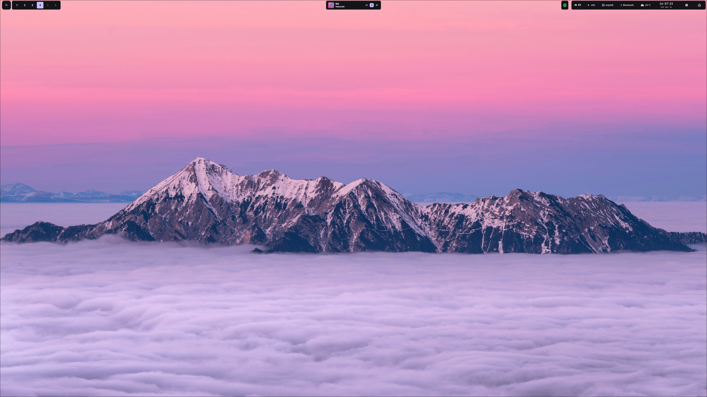
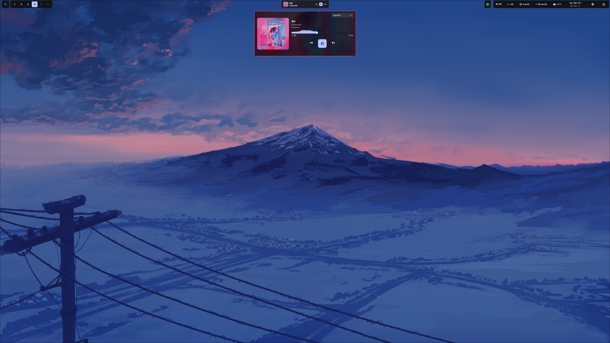
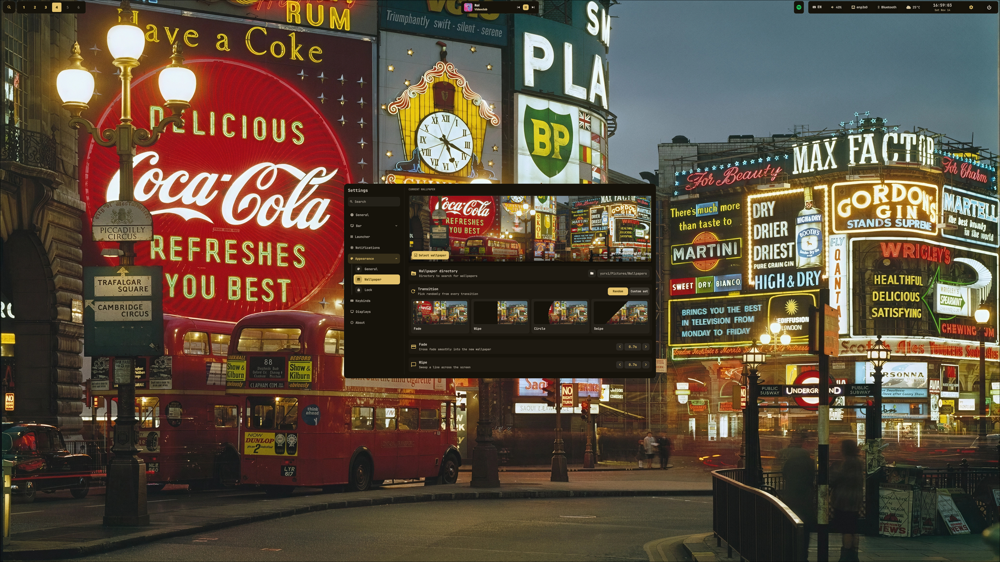
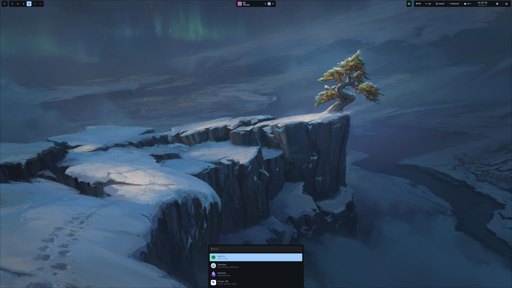

<div align="center">

# NixOS-Config

**A repo that contains my personal NixOS configuration.**

</div>


# Previews
| | |
|---|---|
|  | |
|  |  |

---

# Overview
- Window manager: Hyprland
- Shell: Quickshell
- Terminal: Alacritty
- Shell: fish
- File manager: Thunar
- Browser: Librewolf
- Colors: matugen, generated from the wallpaper
- Font: JetBrains Mono Nerd Font

## Keybinds
| Key | Action |
|---|---|
| `Super` + `T` | Terminal |
| `Super` + `E` | File manager |
| `Super` + `W` | Librewolf (Browser) |
| `Super` (tap) | App launcher |
| `Super` + `Q` | Close window |
| `Super` + `L` | Lock screen  |
| `Super` + `S` | Screenshot |
| `Super` + ``` ` ``` | Wallpaper menu |

## Installtion
> [!WARNING]
> Install only if you understand the risk. I am not responsible for any issues that may arise from using this setup.
Arch and other distros
``` sh
bash -c "$(curl -fsSL https://raw.githubusercontent.com/ashvr0/NixOS-Config/main/install.sh)"
```
---
For NixOS
```
Comming soon...
```

## Notes

If you encounter issues, open an issue: [issue](https://github.com/ashvr0/NixOS-Config/issues/new).

This project is licensed under the **GPL** see the [LICENSE](LICENSE.md) file for details.